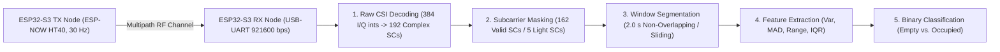

# System Architecture, Hardware Setup & Real-Time Inference

This document details the physical hardware configuration, signal processing and machine learning pipeline architecture, benchmark results, and real-time inference monitor for the **Wi-Fi CSI Presence Detection** system.

---

## 1. System Pipeline Architecture

Two ESP32-S3-DevKitC-1U nodes form a dedicated TX/RX wireless link operating over IEEE 802.11n HT40 (40 MHz bandwidth, 2.4 GHz Channel 11) via ESP-NOW at a nominal rate of 30 Hz. When a human occupies the monitored room, their body perturbs multipath propagation, inducing measurable variations across the OFDM subcarriers.



### Pipeline Stages

1. **Data Collection & Parsing (`wifi_csi.parsing`)**
   * ESP32-S3 RX firmware captures raw CSI frames over USB-serial (`921600` bps), saved as `.csv` alongside a Schema v2.0 `_meta.json` sidecar.
   * Each 384-byte payload is decoded into $N_{\text{raw}} = 192$ complex Channel Frequency Response (CFR) coefficients $H(k) = \operatorname{Re}(H_k) + j\operatorname{Im}(H_k)$ and transformed into Euclidean amplitudes $|H(k)|$.
2. **Preprocessing, Masking & Filtering (`wifi_csi.signal`)**
   * Dead guard-band and DC null subcarriers ($\overline{A}_k < 0.5$) are removed via a cross-session intersection mask, retaining **162 shared valid HT40 subcarriers** (or **5 optimal subcarriers** in the Light modality).
   * Configurable temporal denoising supports forward-backward low-pass Butterworth filtering (`cutoff_hz = 3.0`, `order = 3`) and soft-thresholding Daubechies (`db4`) wavelet denoising.
3. **Windowed Statistical Feature Extraction (`wifi_csi.features`)**
   * Continuous amplitude streams are segmented into **2.0-second windows** ($\approx 58\text{–}60$ packets per window).
   * Four statistical dispersion descriptors—**Variance (`var`)**, **Mean Absolute Deviation (`mad`)**, **Peak-to-Peak Range (`range`)**, and **Interquartile Range (`iqr`)**—are computed per subcarrier, yielding:
     * **Full Modality:** $162 \text{ subcarriers} \times 4 \text{ metrics} = \mathbf{648 \text{ features}}$.
     * **Light Modality:** $5 \text{ subcarriers} \times 4 \text{ metrics} = \mathbf{20 \text{ features}}$ ($96.91\%$ dimensionality reduction).
4. **Classification, Robustness & Deployment (`wifi_csi.models`, `wifi_csi.evaluation`)**
   * Supervised binary classifiers (`MLP`, `Gradient Boosting`, `SVM-RBF`, `Random Forest`) wrapped in leak-free `StandardScaler` pipelines classify each 2.0 s window as `empty (0)` or `occupied (1)`.

---

## 2. Experimental Status & Benchmark Summary

| Pipeline Stage | Status | Key Metric / Output |
| :--- | :---: | :--- |
| **Hardware setup & data collection** | Done | ESP32-S3 HT40 link, 24 total recorded sessions across 4 campaigns (`first_test`, `pilot`, `main`, `generalization`) |
| **Signal processing & subcarrier mask** | Done | 162 shared valid HT40 subcarriers (out of 192 raw subcarriers) |
| **Canonical feature dataset (`pipeline_v1`)** | Done | 3,900 windows $\times$ 648 statistical features (2,100 empty, 1,800 occupied) across 11 valid sessions (`C`–`M`) |
| **Full Modality (162 SCs / 648 Features)** | Done | Hold-out test set ($N = 585$): Top models achieve **Macro $F_1 = 0.9828\text{–}0.9948$**, **FAR $\le 0.63\%$** |
| **Light Modality (5 SCs / 20 Features)** | Done | **96.91% DSP reduction**; `gradient_boosting_light` achieves **Macro $F_1 = 0.9759$**, **Accuracy = 97.61%**, **FAR = 0.63%** |
| **OOD Spatial Generalization (2–5 m)** | Done | Light models improve zero-shot cross-environment Macro $F_1$ by $+25\text{ to }+29$ pp over Full models (peaking at $F_1 = 0.9828$ at 3.0 m) |

For full mathematical derivations and ablation metrics, consult:
* [`docs/MATHEMATICAL_FORMULATIONS.md`](MATHEMATICAL_FORMULATIONS.md)
* [`docs/FEATURE_MINIMIZATION.md`](FEATURE_MINIMIZATION.md)
* [`docs/notebooks/04_modeling.md`](notebooks/04_modeling.md)
* [`docs/notebooks/05_generalization.md`](notebooks/05_generalization.md)

---

## 3. Hardware Specification & Physical Geometry

| Component | Qty | Role / Specification |
| :--- | :---: | :--- |
| **ESP32-S3-DevKitC-1U-N8R8** | 2 | Dedicated TX transmitter (`csi_send`) and RX receiver (`csi_recv`) microcontrollers |
| **2.4 GHz Wi-Fi Antenna (3 dBi, U.FL)** | 2 | External omnidirectional antennas connected via U.FL pigtails |
| **Aluminum Tripod (2.1 m max height)** | 2 | Fixed node elevation at **1.20 m** height above floor level |
| **Regulated 5 V Power Supply / Power Bank** | 1 | Standalone power supply for isolated TX node placement |
| **USB Data Cable (USB-A / USB-C to Micro-USB)** | 1 | Connects RX node to host computer for power and `921600` bps UART streaming |

### Radio & Spatial Parameters
* **Protocol:** ESP-NOW over IEEE 802.11n HT40 (Channel 11, 2.4 GHz ISM band, 40 MHz bandwidth).
* **Nominal Packet Rate:** 30 Hz ($\approx 29.0\text{–}29.3\text{ Hz}$ effective host arrival rate).
* **Indoor Benchmark Geometry:** Residential bedroom ($3.40\text{ m} \times 3.45\text{ m} \times 2.85\text{ m}$), 2.00 m Line-of-Sight (LoS) inter-node distance, tested across center still, center moving, and 4 off-center positions (`P1` West off-LoS, `P2` Near-TX, `P3` Near-RX, `P4` East off-LoS).

---

## 4. Real-Time Live Presence Detection Monitor

When the ESP32-S3 RX node is connected via USB-serial and the TX node is powered on, you can launch the live terminal dashboard (`scripts/realtime_presence.py`).

### 4.1 Quick Launch Commands

| Mode / Model | Linux / macOS (`Makefile`) | Windows (`make.bat` / `make.ps1`) | Direct `uv` Command |
| :--- | :--- | :--- | :--- |
| **Interactive Model Menu** | `make live` | `.\make live` | `uv run python scripts/realtime_presence.py` |
| **Recommended Light Model (GBDT Light, 5 SCs)** | `make live-reduced` | `.\make live-reduced` | `uv run python scripts/realtime_presence.py --reduced` |
| **SVM Light (83 KB flash footprint, 5 SCs)** | `make live-svm-light` | `.\make live-svm-light` | `uv run python scripts/realtime_presence.py --model svm_light` |
| **MLP Light (3.5 µs latency, 5 SCs)** | `make live-mlp-light` | `.\make live-mlp-light` | `uv run python scripts/realtime_presence.py --model mlp_light` |
| **Random Forest Light (5 SCs)** | `make live-rf-light` | `.\make live-rf-light` | `uv run python scripts/realtime_presence.py --model random_forest_light` |
| **Gradient Boosting Light (5 SCs)** | `make live-gb-light` | `.\make live-gb-light` | `uv run python scripts/realtime_presence.py --model gradient_boosting_light` |

### 4.2 Command-Line Options (`scripts/realtime_presence.py`)

```bash
uv run python scripts/realtime_presence.py [OPTIONS]
```

* `--port <PORT>`: Serial port device (`auto` by default; e.g., `/dev/ttyUSB0` on Linux, `COM3` on Windows, `/dev/cu.usbserial-0001` on macOS).
* `--baud <BAUD>`: UART baudrate (default: `921600`).
* `--model <NAME>`: Model key to load directly (`mlp`, `random_forest`, `gradient_boosting`, `svm`, `mlp_light`, `random_forest_light`, `gradient_boosting_light`, `svm_light`).
* `--reduced`: Use the optimal 5-subcarrier / 20-feature Light model family.
* `--mode {sliding,tumbling}`: Window evaluation mode (`sliding` evaluates a continuous rolling 2.0 s window at 4 Hz; `tumbling` evaluates discrete non-overlapping 2.0 s windows).
* `--window <SECONDS>`: Window duration in seconds (default: `2.0`).
* `--threshold <FLOAT>`: Probability threshold for `OCCUPIED` classification (default: `0.5`).
* `--plain`: Disable the ANSI box-drawing TUI and output timestamped line-by-line logs for piping or scripting.
