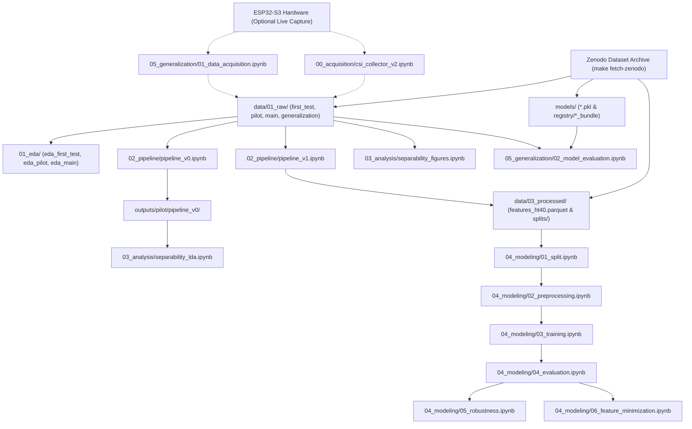

# Jupyter Notebooks Execution & Pipeline Workflow Guide

All stages of the research pipeline—from raw CSI acquisition and exploratory data analysis (EDA) to signal preprocessing, feature extraction, machine learning training, robustness evaluation, and out-of-distribution generalization—are implemented as interactive Jupyter Notebooks in the [`notebooks/`](../notebooks/) directory.

---

## 1. Prerequisites Before Running Notebooks

Before opening or executing the notebooks, ensure you have completed the two initial setup steps from the project root:

1. **Install the virtual environment and notebook dependencies:**
   * **Linux / macOS:** `make install`
   * **Windows:** `.\make install`
   * **Direct `uv`:** `uv sync --extra dev`

2. **Download and restore the Zenodo dataset and trained models:**
   * **Linux / macOS:** `make fetch-zenodo`
   * **Windows:** `.\make fetch-zenodo`
   * **Direct `uv`:** `uv run python scripts/backup_data.py fetch`

> [!IMPORTANT]
> **Why is `fetch-zenodo` required first?**
> Raw CSI recordings (`data/01_raw/`), processed canonical feature tables and splits (`data/03_processed/`), and trained model bundles (`models/`) are excluded from Git tracking due to size (~163 MB compressed) and hosted on Zenodo. Running `make fetch-zenodo` (or `.\make fetch-zenodo`) populates all required directories so every offline notebook can run immediately without needing physical ESP32-S3 hardware.

---

## 2. How to Launch and Execute the Notebooks

You can execute the notebooks using either **JupyterLab / Jupyter Notebook** in your browser or an IDE such as **VS Code / Positron / Cursor**.

### Option A: Launch JupyterLab from the Terminal (Recommended)

Running JupyterLab via `make` or `uv run` guarantees that the server automatically uses the project's `.venv` virtual environment (`wifi_csi`, `numpy`, `scipy`, `PyWavelets`, `scikit-learn`, `pyarrow`, `matplotlib`, `seaborn`):

* **Linux / macOS:**
  ```bash
  make notebook
  # or classic interface: make notebook-classic
  ```
* **Windows (CMD / PowerShell):**
  ```powershell
  .\make notebook
  # or classic interface: .\make notebook-classic
  ```
* **Direct `uv` command (All OSes):**
  ```bash
  uv run jupyter lab
  ```

### Option B: Run Inside VS Code / Cursor / Positron

1. Open the repository root folder (`wifi-csi-presence-detection/`) in your editor.
2. Open any `.ipynb` file inside `notebooks/`.
3. Click **Select Kernel** in the top-right corner of the notebook editor.
4. Choose **Python Environments...** and select the local **`.venv`** interpreter:
   * Linux / macOS: `.venv/bin/python`
   * Windows: `.venv\Scripts\python.exe`

---

## 3. Pipeline Execution Flow & Dependencies

The diagram below illustrates the data flow and execution dependencies across the notebook directories:



---

## 4. Complete Notebook Catalog & Execution Order

### Stage 0 — Hardware Data Acquisition (`notebooks/00_acquisition/`)
> **Detailed Report:** [`docs/notebooks/00_acquisition.md`](notebooks/00_acquisition.md)

| Order | Notebook | Hardware Required? | Inputs | Outputs | Description |
| :---: | :--- | :---: | :--- | :--- | :--- |
| **0.1** | [`csi_collector_v2.ipynb`](../notebooks/00_acquisition/csi_collector_v2.ipynb) | **Yes** (ESP32-S3 RX via USB) | Serial stream (`921600` bps) | `data/01_raw/<campaign>/session_*.csv` & `*_meta.json` | Captures synchronized 690 s CSI sessions and writes Schema v2.0 metadata sidecars. **Skip if using Zenodo data.** |

---

### Stage 1 — Exploratory Data Analysis (`notebooks/01_eda/`)
> **Detailed Report:** [`docs/notebooks/01_eda.md`](notebooks/01_eda.md)

All three EDA notebooks run directly on the raw CSV/JSON sessions restored by `make fetch-zenodo` and can be executed in any order:

| Order | Notebook | Hardware Required? | Inputs | Outputs | Description |
| :---: | :--- | :---: | :--- | :--- | :--- |
| **1.1** | [`eda_first_test.ipynb`](../notebooks/01_eda/eda_first_test.ipynb) | No | `data/01_raw/first_test/` | `outputs/first_test/` | Validates I/Q decoding, 192 HT40 subcarriers, and initial empty vs. occupied separability. |
| **1.2** | [`eda_pilot.ipynb`](../notebooks/01_eda/eda_pilot.ipynb) | No | `data/01_raw/pilot/` | `outputs/pilot/` | Evaluates pilot sessions (C–F), sampling rate stability, jitter, and 4-point quality criteria. |
| **1.3** | [`eda_main.ipynb`](../notebooks/01_eda/eda_main.ipynb) | No | `data/01_raw/main/` | `outputs/main/` | Full benchmark analysis across sessions G–M (175,578 packets), demonstrating CSI sensitivity over RSSI in off-LoS positions. |

---

### Stage 2 — Signal Preprocessing & Feature Extraction (`notebooks/02_pipeline/`)
> **Detailed Report:** [`docs/notebooks/02_pipeline.md`](notebooks/02_pipeline.md)

| Order | Notebook | Hardware Required? | Inputs | Outputs | Description |
| :---: | :--- | :---: | :--- | :--- | :--- |
| **2.1** | [`pipeline_v0.ipynb`](../notebooks/02_pipeline/pipeline_v0.ipynb) | No | `data/01_raw/pilot/` | `outputs/pilot/pipeline_v0/` (`features_v0_ht40.parquet`) | Pilot prototype pipeline (4 sessions, 1,200 windows $\times$ 648 features). **Must be run before `separability_lda.ipynb`.** |
| **2.2** | [`pipeline_v1.ipynb`](../notebooks/02_pipeline/pipeline_v1.ipynb) | No | `data/01_raw/pilot/` + `data/01_raw/main/` | `data/03_processed/features_ht40.parquet` & `.csv`, `valid_subcarrier_mapping.csv` | Production feature extraction pipeline across all 11 valid sessions (C–M), producing 3,900 windows $\times$ 648 statistical features (`var`, `mad`, `range`, `iqr` over 162 shared valid subcarriers). |

---

### Stage 3 — Class Separability Analysis (`notebooks/03_analysis/`)
> **Detailed Report:** [`docs/notebooks/03_analysis.md`](notebooks/03_analysis.md)

| Order | Notebook | Hardware Required? | Prerequisite | Inputs | Outputs | Description |
| :---: | :--- | :---: | :--- | :--- | :--- | :--- |
| **3.1** | [`separability_figures.ipynb`](../notebooks/03_analysis/separability_figures.ipynb) | No | `make fetch-zenodo` | `data/01_raw/pilot/` | `outputs/pilot/figures/` | Temporal amplitude envelopes, IQR bands, windowed MAD dynamics, and publication figures. |
| **3.2** | [`separability_lda.ipynb`](../notebooks/03_analysis/separability_lda.ipynb) | No | Run `02_pipeline/pipeline_v0.ipynb` first | `outputs/pilot/pipeline_v0/features_v0_ht40.parquet` | `outputs/pilot/figures/` | PCA/LDA projections, Kruskal-Wallis tests, Cohen's $d$, and per-subcarrier ANOVA F-tests. |

---

### Stage 4 — Machine Learning Modeling, Robustness & Feature Minimization (`notebooks/04_modeling/`)
> **Detailed Reports:** [`docs/notebooks/04_modeling.md`](notebooks/04_modeling.md) & [`docs/FEATURE_MINIMIZATION.md`](FEATURE_MINIMIZATION.md)

> [!WARNING]
> **Strict Sequential Order in `04_modeling/`:**
> Although `make fetch-zenodo` pre-populates `data/03_processed/splits/` and `models/`, `05_robustness.ipynb` requires `reports/logs/metrics_report.json`, which is generated dynamically by running `04_evaluation.ipynb`. Always execute `01` $\to$ `02` $\to$ `03` $\to$ `04` $\to$ `05` $\to$ `06` in order when reproducing the modeling stage.

| Order | Notebook | Inputs | Outputs | Description |
| :---: | :--- | :--- | :--- | :--- |
| **4.1** | [`01_split.ipynb`](../notebooks/04_modeling/01_split.ipynb) | `data/03_processed/features_ht40.csv` | `data/03_processed/splits/{train,val,test}.parquet` | Stratified 70% / 15% / 15% dataset partitioning. |
| **4.2** | [`02_preprocessing.ipynb`](../notebooks/04_modeling/02_preprocessing.ipynb) | `splits/train.parquet` | `models/scaler.pkl` | Leakage-free `StandardScaler` fitting on the training split. |
| **4.3** | [`03_training.ipynb`](../notebooks/04_modeling/03_training.ipynb) | `splits/train.parquet`, `models/scaler.pkl` | `models/{mlp,svm,gradient_boosting,random_forest}.pkl`, `models/registry/*_bundle/` | 10-fold Stratified CV and `GridSearchCV` hyperparameter tuning across 4 architectures. |
| **4.4** | [`04_evaluation.ipynb`](../notebooks/04_modeling/04_evaluation.ipynb) | `splits/{val,test}.parquet`, `models/*.pkl` | `reports/logs/metrics_report.json`, `reports/figures/`, `reports/tables/` | Validation model selection, learning curves, and single blind evaluation on the hold-out test set. |
| **4.5** | [`05_robustness.ipynb`](../notebooks/04_modeling/05_robustness.ipynb) | `reports/logs/metrics_report.json`, `splits/test.parquet`, `data/01_raw/*/*_meta.json` | `reports/tables/robustness_*.{csv,tex}`, `reports/figures/` | Granular subgroup evaluation by session, spatial posture (`p1`–`p4`), and time of day. |
| **4.6** | [`06_feature_minimization.ipynb`](../notebooks/04_modeling/06_feature_minimization.ipynb) | `splits/{train,val,test}.parquet`, `valid_subcarrier_mapping.csv` | `models/*_light.pkl`, `models/registry/*_light_bundle/`, `reports/logs/optimal_features.json` | Physical subcarrier permutation importance (5-fold `StratifiedGroupKFold`), 1-SE stopping rule ($N^* = 5$ subcarriers / 20 features, $-96.91\%$ DSP), and Light model family training. |

---

### Stage 5 — Out-of-Distribution Spatial & Environmental Generalization (`notebooks/05_generalization/`)
> **Detailed Report:** [`docs/notebooks/05_generalization.md`](notebooks/05_generalization.md)

| Order | Notebook | Hardware Required? | Inputs | Outputs | Description |
| :---: | :--- | :---: | :--- | :--- | :--- |
| **5.1** | [`01_data_acquisition.ipynb`](../notebooks/05_generalization/01_data_acquisition.ipynb) | **Yes** (ESP32-S3 RX via USB) | Serial stream (`921600` bps) | `data/01_raw/generalization/session_G*.{csv,json}` | Captures OOD sessions across 2.0 m, 3.0 m, 4.0 m, and 5.0 m distances. **Skip if using Zenodo data.** |
| **5.2** | [`02_model_evaluation.ipynb`](../notebooks/05_generalization/02_model_evaluation.ipynb) | No | `data/01_raw/generalization/`, `models/registry/*_bundle/` | `outputs/generalization/` (metrics, reports, & plots) | Zero-retraining evaluation comparing all 4 Full models (648 features) against all 4 Light models (20 features) in an unseen outdoor environment across 2–5 m distances. |
